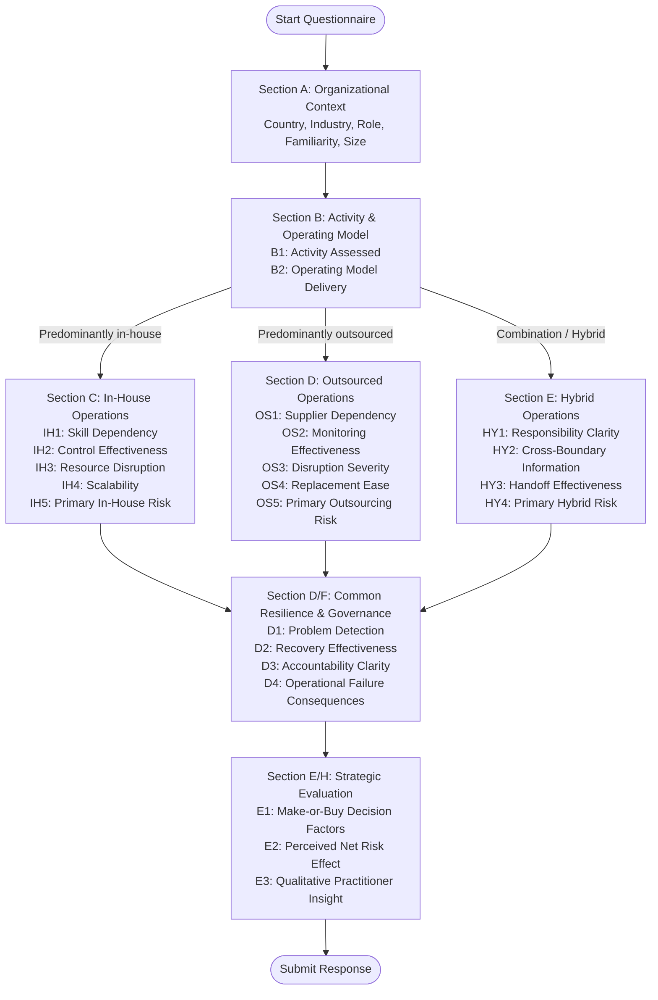

# Chapter 3: Research Methodology

## 3.1 Research Approach and Comparative Design

This thesis investigates how operating model choices—specifically in-house execution, outsourcing, and hybrid arrangements—affect an organization's operational and strategic risk profile. To address this problem, we adopted an applied, quantitative-descriptive and comparative research design based on primary empirical survey data collected from industrial and technical enterprises across Europe. 

Methodologically, the study is situated at the intersection of operations management, strategic management, and organizational risk governance. Rather than approaching operating models through a normative assumption that either internal execution or market procurement is inherently superior, our research is framed around a structural comparative perspective. We examine how the allocation of operational activities alters:
1. Resource configuration;
2. Distribution of direct versus contractual control;
3. Dependency structures;
4. Specific operational and strategic risk exposures;
5. Disruption consequences;
6. Detection, response, and recovery capabilities; and
7. The resulting residual risk profile.

The analytical sequence governing the entire research methodology is formalized as follows:

$$\text{Operating Model} \longrightarrow \text{Resource Configuration} \longrightarrow \text{Control Distribution} \longrightarrow \text{Dependency Structure} \longrightarrow \text{Risk Exposure} \longrightarrow \text{Consequences} \longrightarrow \text{Response/Recovery} \longrightarrow \text{Residual Risk}$$

A cross-sectional survey design was selected as the most appropriate research instrument for this investigation. Cross-sectional survey research enables the standardized collection of comparable data across multiple organizations, diverse industrial sectors, and varied geographic contexts within a defined timeframe (Saunders et al. 2019). It provides a structured mechanism to capture professional assessments from experienced practitioners who possess direct operational and decision-making visibility over company arrangements. 

In line with sound academic research practice, we explicitly recognize the epistemological boundaries of this design. The study is comparative and exploratory; it examines reported organizational experiences and professional assessments. Because cross-sectional survey data do not involve experimental manipulation or longitudinal tracking, they cannot establish strict causal proof that an operating model uniquely causes a specific risk outcome. Consequently, throughout this report, we maintain methodological discipline: we describe observed distributions, report comparative associations, and interpret practitioners' evaluations without making unsupported causal assertions.

---

## 3.2 Unit of Analysis and Contextual Demarcation

A critical methodological challenge in outsourcing research is defining the appropriate unit of analysis. Many prior studies treat the entire company as either "in-house" or "outsourced." However, modern industrial enterprises rarely operate under a single, monolithic delivery model across all functions. A manufacturing company may maintain core production strictly in-house while fully outsourcing information technology and employing a hybrid arrangement for facility maintenance and logistics.

To ensure empirical validity, the **unit of analysis in this research is defined as a specific operating activity** within the respondent's organization, rather than the company as an undifferentiated whole. In Section B of the questionnaire, respondents were required to identify the single operating activity that they were best qualified to assess—such as *production or service delivery*, *maintenance or asset management*, *IT or technology services*, *logistics or facilities*, or *procurement and supply chain*. All subsequent evaluative ratings concerning dependencies, controls, disruptions, governance, and failure consequences were anchored strictly to that designated activity. This design choice prevents cross-functional confounding and ensures that risk ratings reflect concrete operational realities.

---

## 3.3 Operationalization of Variables

To bridge the theoretical knowledge base (Chapter 2) with empirical measurement, we operationalized the conceptual framework into measurable survey variables. The survey instrument was organized into seven logical modules (Sections A through E), comprising 28 core survey variables alongside a unique respondent identifier (`profile_id`). Table 3.1 details the complete operationalization schema, illustrating the alignment between survey questions, empirical variables, measurement scales, and the supporting research questions (RQ1–RQ5).

### Table 3.1. Operationalization of Survey Variables and Research Question Alignment

| Question Code | Survey Variable Name | Theoretical / Conceptual Dimension | Measurement Level & Scale | Thesis RQ Alignment |
| :--- | :--- | :--- | :--- | :--- |
| **A1** | `country` | Geographic operating context | Categorical (Country list) | Context / Sampling |
| **A2** | `industry` | Industrial sector classification | Categorical (12 sectors) | Context variable |
| **A3** | `role_function` | Organizational role / decision function | Categorical (Job titles) | Context / Eligibility |
| **A4** | `knowledge_level` | Operational familiarity & responsibility | Ordinal (4-point responsibility scale) | Survey validity filter |
| **A5** | `company_size` | Enterprise size bracket | Ordinal (1–49, 50–249, 250–999, 1000+) | Control variable |
| **B1** | `activity` | Specific operating activity assessed | Categorical (6 operational areas) | Unit of analysis |
| **B2** | `operating_model` | Core delivery model path | Categorical (In-house / Outsourced / Hybrid) | Primary grouping variable |
| **IH1** | `internal_skill_dependency` | Reliance on internal specialist expertise | Metric rating scale (1–10: Low to High) | RQ1 (Operational risk factors) |
| **IH2** | `internal_control_effectiveness`| Direct quality and process control | Metric rating scale (1–10: Poor to Excellent) | RQ1, RQ3 (Control) |
| **IH3** | `internal_resource_disruption` | Severity of impact if key staff unavailable | Metric rating scale (1–10: Low to High) | RQ1 (Continuity risk) |
| **IH4** | `internal_scalability` | Capacity scaling flexibility | Metric rating scale (1–5: Difficult to Easy) | RQ1 (Operational flexibility) |
| **IH5** | `primary_inhouse_risk` | Primary structural in-house vulnerability | Categorical (*Staff Shortage* vs *Skill Scarcity*) | RQ1 (Risk identification) |
| **OS1** | `supplier_dependency` | Reliance on external service provider | Metric rating scale (1–10: Low to High) | RQ1 (Operational risk factors) |
| **OS2** | `supplier_monitoring_effectiveness`| Ability to monitor and enforce SLA quality | Metric rating scale (1–10: Poor to Excellent) | RQ1, RQ3 (Governance/Control) |
| **OS3** | `supplier_disruption` | Severity of impact if provider fails | Metric rating scale (1–10: Low to High) | RQ1 (Continuity risk) |
| **OS4** | `provider_replacement_ease` | Ease of switching or insourcing provider | Metric rating scale (1–5: Difficult to Easy) | RQ1 (Switching/Lock-in risk) |
| **OS5** | `primary_outsourcing_risk` | Primary structural outsourcing vulnerability | Categorical (*Supplier Performance* vs *Single Supplier*) | RQ1 (Risk identification) |
| **HY1** | `responsibility_clarity` | Clarity of internal vs external duties | Metric rating scale (1–10: Poor to Excellent) | RQ3 (Governance/Accountability) |
| **HY2** | `cross_boundary_information` | Information sharing across boundaries | Metric rating scale (1–10: Poor to Excellent) | RQ3 (Communication) |
| **HY3** | `handoff_effectiveness` | Management of operational handoffs | Metric rating scale (1–10: Poor to Excellent) | RQ3 (Coordination) |
| **HY4** | `primary_hybrid_risk` | Primary structural hybrid vulnerability | Categorical (*Coordination Failure Risk*) | RQ1 (Risk identification) |
| **D1** | `problem_detection` | Speed of early problem detection | Metric rating scale (1–10: Poor to Excellent) | RQ4 (Resilience/Monitoring) |
| **D2** | `recovery_effectiveness` | Speed and efficacy of service recovery | Metric rating scale (1–10: Poor to Excellent) | RQ4 (Resilience/Recovery) |
| **D3** | `accountability_clarity` | Overall clarity of decision accountability | Metric rating scale (1–10: Poor to Excellent) | RQ3 (Governance) |
| **D4** | `failure_consequences` | Significant consequences upon failure | Multi-selection categorical string | RQ1 (Impact analysis) |
| **E1** | `make_buy_factors` | Decision criteria in make-or-buy choices | Multi-selection categorical string | RQ5 (Decision factors) |
| **E2** | `overall_risk_effect` | Directional impact on business risk profile | Categorical (*Trade-off* vs *Increased*) | RQ2 (Business risk shift) |
| **E3** | `additional_insight` | Qualitative practitioner insight | Open-ended text field | Supplemental qualitative |

### Measurement Scale Design:
- **Intensity and Effectiveness Constructs (`IH1`–`IH3`, `OS1`–`OS3`, `HY1`–`HY3`, `D1`–`D3`):** Measured using 10-point numerical rating scales anchored with explicit conceptual endpoints (1 = Very Low / Ineffective, 10 = Very High / Highly Effective). A 10-point scale provides sufficient granularity for respondents to convey nuanced operational assessments without artificially constraining variance (DeVellis 2017).
- **Flexibility and Switching Constructs (`IH4`, `OS4`):** Measured using 5-point rating scales (1 = Very Difficult, 5 = Very Easy), reflecting standard operational elasticity indices.
- **Categorical Risk Allocations (`IH5`, `OS5`, `HY4`):** Harmonized directly with the primary risk taxonomy established in our conceptual Mermaid framework (`Staff Shortage Risk`, `Single-Point Skill Risk`, `Supplier Performance Risk`, `Single Supplier Risk`, and `Coordination Failure Risk`).
- **Impact and Decision Grids (`D4`, `E1`):** Multi-selection grids enabling practitioners to identify multiple concurrent consequences and decision factors without forcing unrealistic single-attribute choices.

---

## 3.4 Target Population and Sampling Strategy

The target population for this study comprises operational managers, procurement leaders, supply chain executives, and technical directors working within industrial and commercial enterprises across Europe that actively make or manage operating model decisions. 

Because an exhaustive, centralized sampling frame of European operational decision-makers does not exist, a **purposive professional sampling strategy** (non-probability sampling) was implemented. Purposive sampling is well suited for specialized organizational studies where participants must possess specific functional expertise and direct operational visibility to provide valid data (Saunders et al. 2019).

### 3.4.1 Geographic Allocation and Recruitment Targets
The research design established an initial outreach pool adhering to a defined geographic balance:
- **Finland (Domestic Baseline Context):** Approximately 40% of the sample.
- **Rest of Europe (International Comparative Context):** Approximately 60% of the sample, incorporating Nordic peers (Sweden, Norway, Denmark), Western European economies (Germany, France, Netherlands, Belgium, UK), Southern Europe (Spain, Italy), and Central/Eastern Europe (Poland).

The sample size targets set during the thesis planning phase were:
- **Minimum Acceptable Sample Size:** 25 usable responses ($N \ge 25$).
- **Preferred Target Range:** 30 to 40 usable responses.

These targets represent practical, defensible thresholds for exploratory academic research at the Bachelor's thesis level. The current analysis dataset contains 30 respondent records. The questionnaire did not request respondents’ names. These records must not be described as 30 organisations because the questionnaire did not establish whether respondents represented unique organisations. Geographic distribution and data completeness must be confirmed against the finalised analysis export.

### 3.4.2 Eligibility Criteria and Survey Validity Screening
To prevent unqualified respondents from distorting the findings, strict inclusion criteria were enforced:
1. The respondent must be currently employed in an industrial, technical, commercial, or public infrastructure enterprise operating in Europe.
2. The respondent must hold a role with operational, procurement, engineering, supply chain, maintenance, quality, or executive oversight.
3. The respondent must possess direct familiarity with the assessed activity. In question A4 (`knowledge_level`), respondents self-identified their level of involvement. Anyone selecting "Limited familiarity" was subject to exclusion. In our achieved sample, 73.4% ($n = 22$) were directly responsible for or managed the activity, and 26.6% ($n = 8$) regularly supported decisions or held substantial professional experience. Zero respondents selected limited familiarity, verifying 100% eligibility compliance.

---

## 3.5 Data Collection Instrument and Branching Logic

Data collection was executed using a structured, self-administered digital questionnaire built and deployed on the secure **Tally** survey platform (accessible at `https://tally.so/r/RGXG6j`). The digital questionnaire was engineered to minimize respondent fatigue, with an estimated completion duration of 6 to 9 minutes.

### 3.5.1 Conditional Branching Architecture
A critical design requirement of the questionnaire was dynamic conditional routing. Because operating arrangements involve distinct mechanisms, asking an in-house manager about external vendor KPIs or forcing an outsourcing manager to evaluate internal staffing levels would generate invalid data. 

To resolve this, the survey implemented strict conditional branching logic, illustrated in the flow diagram below:

- **Branching Rules:**
  - Respondents selecting *Predominantly in-house* were routed exclusively to Section C (In-House Operations), skipping Sections D and E.
  - Respondents selecting *Predominantly outsourced* were routed exclusively to Section D (Outsourced Operations), skipping Sections C and E.
  - Respondents selecting *A combination of in-house and outsourced* were routed exclusively to Section E (Hybrid Operations), skipping Sections C and D.
  - All paths converged seamlessly onto the Common Resilience and Governance module (`D1`–`D4`) and the final Strategic Make-or-Buy module (`E1`–`E3`).
  - This architecture ensured that every respondent completed only questions relevant to their lived operational experience while answering identical benchmark questions for cross-model comparison.

---

## 3.6 Data Processing and Analytical Methods

The raw data exported from the survey platform underwent structured verification, cleaning, and preparation before statistical analysis.

### 3.6.1 Data Cleaning and Transformation
1. **Structural Integrity Verification:** Upon export from the survey platform, the raw dataset was subjected to a full structural audit. Each record was validated against the 29-column schema defined in the operationalization framework. Where field alignments were inconsistent with the branching architecture of the instrument, records were systematically reconstructed to their correct column positions prior to analysis, The final completeness assessment must distinguish fields applicable to each respondent from branch-specific fields that were not displayed. Blank cells for unvisited conditional branches are structurally not applicable, not missing answers. The final count of missing answers to questions actually presented must be reported after the researchers complete the dataset review.
2. **Header Normalization:** Generic platform-generated question codes were replaced with the official snake_case survey variable names (`profile_id`, `country`, `internal_skill_dependency`, etc.) established in the operationalization schema (Table 3.1). Any duplicate or redundant platform fields were removed, with `operating_model` retained as the sole primary grouping variable.
3. **Categorical Harmonization:** Primary in-house, outsourced, and hybrid risk classifications were mapped to the five conceptual risk nodes defined in the analytical framework, and failure consequences were standardized against the five theoretical impact nodes to enable direct cross-model comparison.
4. **Data Preservation:** The original raw export was securely archived as an unmodified reference copy, while the verified, harmonized dataset was designated the frozen master analysis file and saved as [`DATA/responses.csv`](file:///c:/Users/Sav-Dev/Documents/research-validation-tables/BSC-STUDENT-RESEARCH/KINGSLEY%20AND%20XXX/DATA/responses.csv). Access to both files was restricted to the two student researchers in compliance with the Karelia UAS Data Management Plan.

### 3.6.2 Statistical Analysis Techniques
Because the dataset comprises $N = 30$ observations, data analysis focused on robust descriptive statistics and comparative cross-tabulations:
- **Measures of Central Tendency and Dispersion:** For metric rating scales (`IH1`–`IH3`, `OS1`–`OS3`, `HY1`–`HY3`, `D1`–`D3`), both **Means** and **Medians** were calculated, accompanied by **Standard Deviations (SD)** and minimum/maximum ranges. Given the ordinal nature of Likert scales and potential skewness in small samples, reporting the median alongside the mean prevents over-reliance on parametric assumptions (Jamieson 2004).
- **Frequency and Percentage Distributions:** Categorical variables (`country`, `industry`, `company_size`, `role_function`, `activity`, `operating_model`, and primary risk types) were summarized using absolute counts ($n$) and relative percentages ($n/N$), with denominators explicitly stated.
- **Cross-Tabulations and Comparative Subgroup Analysis:** Comparative evaluations between in-house ($n=9$), outsourced ($n=12$), and hybrid ($n=9$) groups were conducted for resilience metrics (`D1`, `D2`, `D3`), consequence profiles (`D4`), and net risk effects (`E2`).
- **Optional open-text responses:** The additional-insight field is supplementary. Qualitative content analysis will be reported only if the final dataset contains sufficient usable text and a documented coding procedure is applied. If no usable text is available, no qualitative analysis will be claimed.

---

## 3.7 Research Ethics, Data Protection, and Integrity

The research was planned with reference to Karelia UAS thesis instructions and Finnish National Board on Research Integrity guidance. The thesis supervisor has given the researchers permission to proceed. No formal ethics-review decision is recorded in the project information available for this revision. Any additional review, permit or institutional determination should be described only when its status is confirmed.

### 3.7.1 Voluntary Participation and Informed Consent
Participation in the study was entirely voluntary. Prior to starting the questionnaire, prospective respondents were presented with a formal Participant Information Notice detailing:
- The academic nature and objectives of the research;
- The identity and institutional affiliation of the two student researchers (Karelia UAS);
- The voluntary nature of participation, including the right to withdraw at any time prior to submission;
- Clear instructions advising respondents not to submit confidential business secrets, intellectual property, or proprietary financial records.

The consent mechanism must be described using the exact participant information and consent wording shown to respondents. Do not infer that submission alone constituted informed consent unless the final questionnaire and participant notice establish this.

### 3.7.2 Data Protection and GDPR Compliance
In accordance with the European Union General Data Protection Regulation (GDPR) and our Data Management Plan ([`Data Management Plan 2.docx`](file:///c:/Users/Sav-Dev/Documents/research-validation-tables/BSC-STUDENT-RESEARCH/KINGSLEY%20AND%20XXX/Data%20Management%20Plan%202.docx)):
- **Data Minimization:** The questionnaire did not request respondents’ names. Any claim about collection or non-collection of email addresses, telephone numbers, IP addresses or other technical metadata must be checked against the Tally configuration and platform export.
- **Segregation of Contact Data:** Prospective recruitment contact lists (stored in [`contacts/`](file:///c:/Users/Sav-Dev/Documents/research-validation-tables/BSC-STUDENT-RESEARCH/KINGSLEY%20AND%20XXX/contacts/)) were stored strictly separately from the survey response dataset ([`DATA/responses.csv`](file:///c:/Users/Sav-Dev/Documents/research-validation-tables/BSC-STUDENT-RESEARCH/KINGSLEY%20AND%20XXX/DATA/responses.csv)). The absence of a name field does not by itself establish complete anonymity. The researchers should assess whether combinations of country, role, industry and company-size information could indirectly identify a respondent.
- **Data Storage and Retention:** Research data are stored securely on password-protected devices with restricted access limited solely to the two researchers. In accordance with Karelia UAS policy, research data will be securely retained until thesis assessment and grading are finalized, after which the working files will be permanently and securely deleted.

---

## 3.8 Methodological Limitations

Honest academic reporting requires acknowledging the methodological boundaries of the research:
1. **Sample Size ($N = 30$):** While meeting the thesis planning threshold ($N \ge 25$) and providing rich comparative depth across three models ($n = 9, 12, 9$), a sample of 30 respondents is not statistically representative of all European industry. Statistical findings must be interpreted as exploratory patterns rather than generalizable population parameters.
2. **Non-Probability Purposive Sampling:** Participants were recruited through targeted industry outreach. Although this ensured high operational expertise, purposive sampling introduces potential self-selection bias, as professionals who have experienced significant operational disruptions or make-or-buy reviews may have been more motivated to participate.
3. **Cross-Sectional Perceptual Data:** The survey captured self-reported professional assessments at a single point in time. While practitioners' perceptions directly drive organizational decision-making, they do not constitute objective, longitudinal logs of incident frequencies or accounting costs.
4. **Non-Causal Interpretation:** Differences observed between operating models reflect comparative distributions and structural associations. We do not claim that adopting outsourcing *causes* poorer problem detection, but rather that outsourced configurations are *associated* with structural monitoring challenges due to organizational boundaries.
