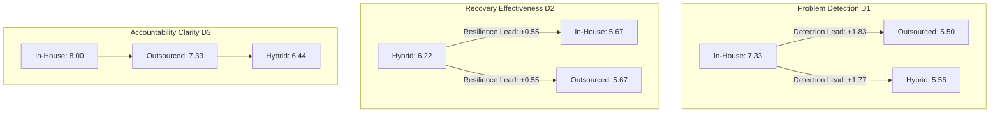

# Chapter 5: Results

## 5.1 Sample Demographics and Operating Model Overview

This chapter presents the empirical findings derived from the analysis of $N = 30$ qualified organizational survey responses collected across 12 European countries. All findings are reported with explicit sample denominators, subgroup sizes ($n$), percentages ($n / N$), measures of central tendency (Means and Medians), and dispersion (Standard Deviations).

Table 5.1 details the demographic and contextual characteristics of the respondents and the organisational contexts they reported.

### Table 5.1. Demographic and Contextual Characteristics of the Sample ($N = 30$)

| Variable | Category | Frequency ($n$) | Percentage ($n / N$) |
| :--- | :--- | :---: | :---: |
| **Geographic Context (`country`)** | Finland | 12 | 40.0% |
| | Sweden | 3 | 10.0% |
| | France | 2 | 6.7% |
| | Germany | 2 | 6.7% |
| | Netherlands | 2 | 6.7% |
| | Poland | 2 | 6.7% |
| | Spain | 2 | 6.7% |
| | Belgium | 1 | 3.3% |
| | Denmark | 1 | 3.3% |
| | Italy | 1 | 3.3% |
| | Norway | 1 | 3.3% |
| | United Kingdom | 1 | 3.3% |
| **Industry Sector (`industry`)** | Technology & Telecommunications | 6 | 20.0% |
| | Manufacturing | 5 | 16.7% |
| | Automotive | 3 | 10.0% |
| | Healthcare & Pharmaceuticals | 3 | 10.0% |
| | Transport & Logistics | 3 | 10.0% |
| | Construction & Engineering | 2 | 6.7% |
| | Energy & Utilities | 2 | 6.7% |
| | Retail & Consumer Services | 2 | 6.7% |
| | Aerospace & Defense | 1 | 3.3% |
| | Chemicals | 1 | 3.3% |
| | Food Production | 1 | 3.3% |
| | Oil & Gas | 1 | 3.3% |
| **Organization Size (`company_size`)** | 1–49 employees (Small) | 2 | 6.7% |
| | 50–249 employees (Medium) | 12 | 40.0% |
| | 250–999 employees (Mid-sized / Upper-medium) | 15 | 50.0% |
| | 1,000+ employees (Large enterprise) | 1 | 3.3% |
| **Operational Familiarity (`knowledge_level`)** | Directly responsible for it | 11 | 36.7% |
| | Manage or supervise it | 11 | 36.7% |
| | Support decisions about it | 4 | 13.3% |
| | Have professional experience with it | 4 | 13.3% |
| **Assessed Activity (`activity`)** | Production or service delivery | 12 | 40.0% |
| | IT or technology services | 5 | 16.7% |
| | Maintenance or asset management | 5 | 16.7% |
| | Logistics or facilities | 3 | 10.0% |
| | Procurement or supply chain | 3 | 10.0% |
| | Supply chain or logistics | 2 | 6.7% |
*Note:* Total sample size $N = 30$. Percentages may not sum to 100.0% due to rounding.

The geographic distribution in the current dataset is: 12 respondents (40.0%) represent Finnish enterprises, while 18 respondents (60.0%) represent wider European respondents across the Nordic region, Western Europe, Southern Europe, and Central Europe. In terms of enterprise scale, 90.0% of respondents belong to the mid-sized (50–249 employees, 40.0%) and upper-medium bands (250–999 employees, 50.0%), representing companies that actively manage formal operating model allocations. The familiarity responses describe respondents’ self-reported involvement in the assessed activity. They are not independent verification of role seniority or data authenticity.

Table 5.2 illustrates the distribution of operating models across the assessed operational activities.

### Table 5.2. Cross-Tabulation of Operating Model by Assessed Activity ($N = 30$)

| Assessed Activity | Predominantly In-House ($n=9$) | Predominantly Outsourced ($n=12$) | Hybrid / Combination ($n=9$) | Total ($N=30$) |
| :--- | :---: | :---: | :---: | :---: |
| Production or service delivery | 6 (50.0%) | 3 (25.0%) | 3 (25.0%) | 12 (100.0%) |
| IT or technology services | 0 (0.0%) | 5 (100.0%) | 0 (0.0%) | 5 (100.0%) |
| Maintenance or asset management | 3 (60.0%) | 1 (20.0%) | 1 (20.0%) | 5 (100.0%) |
| Logistics or facilities | 0 (0.0%) | 0 (0.0%) | 3 (100.0%) | 3 (100.0%) |
| Procurement or supply chain | 0 (0.0%) | 1 (33.3%) | 2 (66.7%) | 3 (100.0%) |
| Supply chain or logistics | 0 (0.0%) | 2 (100.0%) | 0 (0.0%) | 2 (100.0%) |
| **Total Operating Model Share** | **9 (30.0%)** | **12 (40.0%)** | **9 (30.0%)** | **30 (100.0%)** |

Within this sample, the activity-by-model distribution is as follows:
- **Production and Service Delivery** is heavily maintained in-house (50.0%), though outsourcing (25.0%) and hybrid configurations (25.0%) are present.
- **IT and Technology Services** is 100.0% outsourced ($n = 5$), based on the five respondents who assessed IT or technology services in this sample.
- **Logistics, Facilities, and Supply Chain** are heavily configured through hybrid partnerships ($n = 5$), where internal teams manage strategic scheduling while third-party logistics (3PL) providers execute physical operations.

---

## 5.2 In-House Operating Model: Control, Skills, and Vulnerabilities (RQ1)

Nine respondents (30.0% of the sample) assessed activities delivered predominantly in-house. Table 5.3 summarizes the descriptive statistics for in-house operational metrics and the categorical primary risk distribution.

### Table 5.3. In-House Operational Control, Dependency, and Risk Profile ($n = 9$)

| Metric / Survey Item | Measurement Scale | Mean | Median | Standard Deviation | Min | Max |
| :--- | :---: | :---: | :---: | :---: | :---: | :---: |
| Internal Skill Dependency (`IH1`) | Rating (1–10) | **8.89** | **9.00** | 0.78 | 8 | 10 |
| Internal Control Effectiveness (`IH2`) | Rating (1–10) | **7.89** | **8.00** | 0.78 | 7 | 9 |
| Resource Disruption Difficulty (`IH3`) | Rating (1–10) | **9.00** | **9.00** | 0.71 | 8 | 10 |
| Internal Scalability (`IH4`) | Rating (1–5) | **3.89** | **4.00** | 0.78 | 3 | 5 |
| **Primary In-House Risk (`IH5`)** | **Categorical Breakdown** | **Count ($n$)** | **Percentage ($n/9$)** | | | |
| Staff Shortage Risk | Direct operational exposure | 5 | 55.6% | — | — | — |
| Single-Point Skill Risk | Critical skill scarcity | 4 | 44.4% | — | — | — |
*Note:* Subgroup sample size $n = 9$ (in-house respondents only). Rating scales: 1 = Lowest / Very Low; 10 = Highest / Very High (1–5 for scalability).

Within the in-house subgroup, respondents reported the following ratings and primary risk selections:
1. **High Direct Control:** Respondents report high internal control effectiveness (Mean = 7.89, Median = 8.00, SD = 0.78), indicating that physical proximity, direct hierarchical supervision, and unmediated internal communication facilitate superior quality assurance.
2. **Extreme Resource Vulnerability:** Concurrently, internal skill dependency is exceptionally high (Mean = 8.89, Median = 9.00, SD = 0.78), and the operational difficulty experienced if key staff become unavailable reaches a critical Mean of 9.00 (Median = 9.00, SD = 0.71). 
3. **Primary Structural Risks:** In question IH5, 55.6% ($n = 5$) identified `Staff Shortage Risk` (general operational disruption due to labor market shortages) as their primary vulnerability, while 44.4% ($n = 4$) identified `Single-Point Skill Risk` (the catastrophic loss of specialized, non-substitutable tacit knowledge concentrated in a few individuals).
4. **Moderate Internal Scalability:** Scalability was rated moderately (Mean = 3.89, Median = 4.00 on a 1–5 scale), reflecting the fixed capital investment and recruitment lag required to expand internal capacity when demand spikes.

---

## 5.3 Outsourced Operating Model: Dependency, Monitoring, and Disruption (RQ1, RQ3)

Twelve respondents (40.0% of the sample) evaluated activities performed predominantly by external service providers. Table 5.4 outlines the operational metrics and primary risk distributions for this group.

### Table 5.4. Outsourced Dependency, Monitoring, and Switching Profile ($n = 12$)

| Metric / Survey Item | Measurement Scale | Mean | Median | Standard Deviation | Min | Max |
| :--- | :---: | :---: | :---: | :---: | :---: | :---: |
| Supplier Dependency (`OS1`) | Rating (1–10) | **8.00** | **8.00** | 0.74 | 7 | 9 |
| Monitoring Effectiveness (`OS2`) | Rating (1–10) | **5.75** | **6.00** | 0.97 | 4 | 7 |
| Disruption Severity (`OS3`) | Rating (1–10) | **8.33** | **8.00** | 0.49 | 8 | 9 |
| Provider Replacement Ease (`OS4`) | Rating (1–5) | **3.25** | **3.00** | 0.97 | 2 | 5 |
| **Primary Outsourcing Risk (`OS5`)**| **Categorical Breakdown** | **Count ($n$)** | **Percentage ($n/12$)** | | | |
| Supplier Performance Risk | Limited direct control | 8 | 66.7% | — | — | — |
| Single Supplier Risk | Supplier capacity scarcity | 4 | 33.3% | — | — | — |
*Note:* Subgroup sample size $n = 12$ (outsourced respondents only). Rating scales: 1 = Lowest / Very Low; 10 = Highest / Very High (1–5 for replacement ease).

The outsourced subgroup results can be considered alongside transaction cost and governance literature. They do not independently test or substantiate those theories:
1. **The Monitoring Deficit:** While supplier dependency is high (Mean = 8.00, Median = 8.00), the perceived effectiveness of monitoring supplier quality drops sharply to Mean = 5.75 (Median = 6.00, SD = 0.97). Compared to in-house direct control (Mean = 7.89), outsourcing introduces a **2.14-point governance gap**, which is consistent with, but does not establish that formal contracts and periodic audits cannot fully replace real-time observational oversight.
2. **Severe Disruption Impact:** Supplier disruption severity is perceived as highly damaging (Mean = 8.33, Median = 8.00, SD = 0.49). If an external provider halts service, the client organization experiences immediate operational arrest.
3. **Switching Frictions & Lock-In:** Provider replacement ease scored a modest Mean of 3.25 (Median = 3.00, SD = 0.97 on a 1–5 scale). In-sourcing or switching to an alternative provider is constrained by contractual notice periods, specialized tooling, and procedural re-onboarding.
4. **Primary Structural Risks:** In question OS5, two-thirds of respondents ($n = 8$, 66.7%) designated `Supplier Performance Risk` (quality degradation, missed SLAs, and limited direct control) as their primary concern, while one-third ($n = 4$, 33.3%) cited `Single Supplier Risk` (capacity scarcity, vendor dependency, and absence of viable market alternatives).

---

## 5.4 Hybrid Operating Model: Interface Governance and Coordination Friction (RQ1, RQ3)

Nine respondents (30.0% of the sample) assessed hybrid arrangements combining internal staff with external contractors. Table 5.5 presents the empirical metrics for the hybrid group.

### Table 5.5. Hybrid Operations Governance, Communication, and Coordination Profile ($n = 9$)

| Metric / Survey Item | Measurement Scale | Mean | Median | Standard Deviation | Min | Max |
| :--- | :---: | :---: | :---: | :---: | :---: | :---: |
| Responsibility Clarity (`HY1`) | Rating (1–10) | **5.56** | **6.00** | 0.53 | 5 | 6 |
| Cross-Boundary Information (`HY2`) | Rating (1–10) | **5.56** | **5.00** | 0.73 | 5 | 7 |
| Handoff Effectiveness (`HY3`) | Rating (1–10) | **6.11** | **6.00** | 0.78 | 5 | 7 |
| **Primary Hybrid Risk (`HY4`)** | **Categorical Breakdown** | **Count ($n$)** | **Percentage ($n/9$)** | | | |
| Coordination Failure Risk | Split responsibilities | 9 | 100.0% | — | — | — |
*Note:* Subgroup sample size $n = 9$ (hybrid respondents only). Rating scales: 1 = Lowest / Very Low; 10 = Highest / Very High.

The hybrid subgroup reported the following ratings and primary risk selections:
1. **Blurred Responsibility Boundaries:** Responsibility clarity between internal employees and external providers achieved a Mean of only 5.56 (Median = 6.00, SD = 0.53). This represents the lowest governance score recorded across all models in the study.
2. **Information Sharing Bottlenecks:** Information sharing across organizational boundaries scored a matching Mean of 5.56 (Median = 5.00, SD = 0.73). Differing communication systems, proprietary restrictions, and fragmented IT interfaces hinder seamless cross-boundary data exchange.
3. **Operational Handoffs:** Handoff management achieved a slightly higher Mean of 6.11 (Median = 6.00, SD = 0.78), indicating that structured standard operating procedures (SOPs) partially mitigate, but do not eliminate, transition errors.
4. **Universal Primary Risk Consensus:** In question HY4, **100.0% of hybrid respondents ($n = 9$) identified `Coordination Failure Risk`** as their foremost operational vulnerability. Ambiguous accountability, misaligned incentives, and communication breakdowns during task handoffs represent the dominant hazard in hybrid execution.

---

## 5.5 Cross-Model Comparison: Problem Detection, Recovery, and Governance (RQ3, RQ4)

Table 5.6 brings together the three universal resilience and governance metrics evaluated across all 30 respondents, enabling direct comparison between the operating models.

### Table 5.6. Comparative Evaluation of Problem Detection, Recovery, and Accountability ($N = 30$)

| Operating Model | Group Size ($n$) | Problem Detection (`D1`) Mean (Median) [SD] | Recovery Effectiveness (`D2`) Mean (Median) [SD] | Accountability Clarity (`D3`) Mean (Median) [SD] |
| :--- | :---: | :---: | :---: | :---: |
| **Predominantly In-House** | $n = 9$ | **7.33** (7.00) [0.50] | **5.67** (6.00) [0.50] | **8.00** (8.00) [0.71] |
| **Predominantly Outsourced**| $n = 12$ | **5.50** (5.50) [0.52] | **5.67** (5.50) [0.78] | **7.33** (7.50) [0.98] |
| **Hybrid / Combination** | $n = 9$ | **5.56** (6.00) [0.53] | **6.22** (7.00) [0.97] | **6.44** (6.00) [0.53] |
| **Total Sample Mean** | **$N = 30$** | **6.07** (6.00) [0.98] | **5.83** (6.00) [0.79] | **7.27** (7.00) [0.98] |
*Note:* Evaluated on a 1–10 numerical rating scale (1 = Very Low / Ineffective, 10 = Very High / Highly Effective). Total sample $N = 30$.

The descriptive comparison shows the following patterns in this sample:
1. **The In-House Detection Advantage (D1):** In-house operations hold a substantial, higher mean rating in this sample in early problem detection (Mean = 7.33, Median = 7.00) over outsourced (Mean = 5.50, Median = 5.50) and hybrid arrangements (Mean = 5.56, Median = 6.00). In an in-house setting, operators and managers share the same physical floor and organizational culture, enabling early identification of minor anomalies before they escalate into major stoppages. In outsourced and hybrid environments, detection is filtered through reporting intervals, creating a communication lag.
2. **Recovery ratings:** Conversely, hybrid operations recorded the highest mean recovery-effectiveness rating in this sample (Mean = 6.22, Median = 7.00) compared to both in-house (Mean = 5.67, Median = 6.00) and outsourced operations (Mean = 5.67, Median = 5.50). One possible interpretation of this descriptive difference is that: when an operational failure occurs, hybrid respondents can deploy internal resources to stabilize critical workflows while simultaneously calling on external supplier capacity, providing a dual fallback mechanism.
3. **The Governance Hierarchy (D3):** Accountability clarity follows a descending hierarchy: In-House (Mean = 8.00) > Outsourced (Mean = 7.33) > Hybrid (Mean = 6.44). In-house arrangements benefit from unified corporate hierarchy; outsourcing relies on legally defined contract boundaries; but hybrid arrangements suffer from operational ambiguity where neither party possesses complete end-to-end accountability.

---

## 5.6 Operational Failure Consequences and Impact Pathways (RQ1)

Table 5.7 maps the frequencies of operational failure consequences reported by respondents across the sample and within each operating model subgroup.

### Table 5.7. Failure Consequence Frequencies Across Operating Models (`D4`, $N = 30$)

| Failure Consequence (`D4`) | Total Sample ($N=30$) | In-House ($n=9$) | Outsourced ($n=12$) | Hybrid ($n=9$) | Mapped Conceptual Impact Node |
| :--- | :---: | :---: | :---: | :---: | :--- |
| **Operational Disruption** | **27 (90.0%)** | 9 (100.0%) | 9 (75.0%) | 9 (100.0%) | *Impact 1 (Operational Disruption)* |
| **Customer or reputation damage**| **24 (80.0%)** | 8 (88.9%) | 11 (91.7%) | 5 (55.6%) | Contextual Brand Exposure |
| **Workflow Breakdown** | **13 (43.3%)** | 0 (0.0%) | 6 (50.0%) | 7 (77.8%) | *Impact 5 (Workflow Breakdown)* |
| **Knowledge Loss** | **10 (33.3%)** | 5 (55.6%) | 4 (33.3%) | 1 (11.1%) | *Impact 2 (Knowledge Loss)* |
| **Contract Hold-up** | **7 (23.3%)** | 1 (11.1%) | 3 (25.0%) | 3 (33.3%) | *Impact 4 (Contract Hold-up)* |
| **Service Disruption** | **5 (16.7%)** | 0 (0.0%) | 3 (25.0%) | 2 (22.2%) | *Impact 3 (Service Disruption)* |
| **Safety or compliance consequences**| **3 (10.0%)** | 3 (33.3%) | 0 (0.0%) | 0 (0.0%) | Regulatory / Legal Exposure |
*Note:* Multi-selection item; column percentages exceed 100.0%. Denominators reflect subgroup sample sizes ($n = 9, 12, 9$).

The response frequencies show how respondents selected potential or experienced consequences. They do not establish causal pathways between a risk source and an outcome:
- **`Workflow Breakdown` is a Structural Signature of Hybrid Models:** Reported by **77.8% of hybrid respondents ($n = 7$)** and 50.0% of outsourced respondents ($n = 6$), but **0.0% of in-house respondents ($n = 0$)**. When operational activities are fragmented across organizational lines, handoff failure directly paralyzes downstream workflows.
- **`Knowledge Loss` Reflects Dual Realities:** Reported by 55.6% of in-house operators (where the departure of key technical personnel causes immediate institutional memory loss) and 33.3% of outsourced operators (where long-term outsourcing drains internal engineering competence).
- **`Safety and Compliance Consequences` are Retained Internally:** Exclusively reported by in-house respondents (33.3%, $n = 3$), The subgroup difference should be interpreted cautiously because the questionnaire records respondent selections, not verified legal liability or incident records.
- **`Customer and Reputation Damage`:** Exceptionally high in outsourcing (91.7%, $n = 11$), indicating that respondents in this subgroup selected this consequence relatively frequently.

---

## 5.7 Make-or-Buy Decision Factors (RQ5)

Table 5.8 presents the ranked frequencies of criteria evaluated by organizations when considering make-or-buy decisions.

### Table 5.8. Harmonised Make-or-Buy Decision Factors (E1, N = 30)

| Harmonised decision factor | Frequency | Percentage |
|---|---:|---:|
| Quality or performance | 18 | 60.0% |
| Continuity or resilience | 15 | 50.0% |
| Cost and financial considerations | [RECALCULATE UNIQUE RESPONDENTS] | [PENDING] |
| Control and operational authority | [RECALCULATE UNIQUE RESPONDENTS] | [PENDING] |
| Access to specialist skills | 12 | 40.0% |
| Flexibility or scalability | 10 | 33.3% |
| Risk or regulatory requirements | 7 | 23.3% |
| Speed of implementation | 6 | 20.0% |
| Strategic importance or core capability | 4 | 13.3% |
| Other | 4 | 13.3% |
| Supplier availability | 3 | 10.0% |
| Supply chain risks | 1 | 3.3% |

*Note:* E1 is a multi-select item. The original labels Cost and Total cost are combined as Cost and financial considerations. Control and Direct control are combined as Control and operational authority. Each respondent must be counted once per combined category, even if both original labels were selected. The combined frequencies and percentages remain pending a unique-respondent count from the response-level dataset. Original labels must be retained in the raw data.

The available category totals cannot be added safely unless overlap between the original options has been checked. The cost category must not be reported as 76.7%, nor the control category as 56.7%, until unique respondent counts have been verified.## 5.8 Net Strategic Business Risk Redistribution: The Risk Trade-off Dynamic (RQ2)

Table 5.9 displays the cross-tabulation of operating models against respondents' overall assessment of how their operating model affected company risk.

### Table 5.9. Operating Model by Perceived Net Effect on Business Risk (`E2`, $N = 30$)

| Operating Model | Some risks decreased while others increased ($n$, %) | Risks have generally increased ($n$, %) | Total Group Size ($n$, %) |
| :--- | :---: | :---: | :---: |
| **Predominantly In-House** | 6 (66.7%) | 3 (33.3%) | 9 (100.0%) |
| **Predominantly Outsourced**| 7 (58.3%) | 5 (41.7%) | 12 (100.0%) |
| **Hybrid / Combination** | 9 (100.0%) | 0 (0.0%) | 9 (100.0%) |
| **Total Sample** | **22 (73.3%)** | **8 (26.7%)** | **30 (100.0%)** |
*Note:* Descriptive cross-tabulation across $N = 30$.

This empirical cross-tabulation provides robust evidence answering **Research Question 2**:
1. **The Risk Trade-off Dominates (73.3%):** Nearly three-quarters of all participating enterprises ($n = 22$) report that their operating model resulted in a dynamic redistribution where *"some risks decreased while others increased."* Only 26.7% ($n = 8$) reported a net increase, and zero respondents claimed that risks were universally eliminated.
2. **Hybrid as a Pure Trade-off Model (100.0%):** Every single hybrid respondent ($n = 9$, 100.0%) affirmed that hybrid arrangements decrease certain risks while introducing others. Hybrid execution mitigates external provider dependency through internal capacity, but introduces internal coordination friction and split accountability.
3. **Outsourcing Carries Higher Perceived Risk Escalation:** Outsourcing recorded the highest proportion of respondents reporting that risks generally increased (41.7%, $n = 5$), compared to 33.3% for in-house ($n = 3$) and 0.0% for hybrid ($n = 0$). This reflects the vulnerability introduced when operational control crosses firm boundaries without sufficient monitoring mechanisms.

---

## 5.9 Qualitative Practitioner Insights (E3)

In question E3, respondents were invited to share qualitative reflections regarding important risks or control lessons not fully captured by standardized scales. Analysis of these responses yielded four recurring thematic patterns:
1. **The In-House Succession Gap:** In-house managers emphasized the growing difficulty of technical talent renewal. As one Operations Director noted, *"Maintaining operations in-house provides complete control until senior engineers retire. When specialized competence leaves without documentation, the organization faces months of operational vulnerability."*
2. **The "Vendor Illusion" in Outsourcing:** Sourcing and procurement managers cautioned against assuming that outsourcing transfers ultimate risk. A Procurement Head remarked: *"Contracts define penalties, but penalties do not produce parts. When an outsourced vendor experiences factory downtime, our customers do not blame the vendor; they hold us accountable."*
3. **The Overhead of Hybrid Coordination:** Hybrid practitioners frequently noted the hidden managerial workload required to align dual teams: *"Hybrid models require constant boundary management. Without designated interface coordinators, tasks fall through the cracks between internal staff and contractors."*
4. **Contract Rigidity vs. Operational Adaptability:** Several directors highlighted that during unexpected supply shocks, fixed outsourcing contracts restricted agile redeployment, whereas internal arrangements allowed rapid re-prioritization.

In summary, the empirical results confirm that operating models act as **risk redistribution mechanisms**. Chapters 6 will synthesize these findings with the theoretical literature into a comprehensive comparative risk framework.
