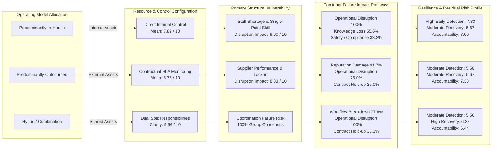

# Chapter 6: Discussion and Conclusions

## 6.1 Theoretical Synthesis and Interpretation of Findings

This study set out to answer a central research question: **How do in-house and outsourced operations affect a company's operational and strategic/business risk profile?** By examining empirical evidence collected from $N = 30$ industrial and technical respondents across Europe alongside established organizational theories, our findings demonstrate that operating models do not determine whether a company has high or low risk in an absolute sense. Rather, **the choice of operating model acts as a structural redistribution mechanism that transforms the location, nature, and governance of organizational risk.**

In this section, we interpret our empirical findings through the four core theoretical lenses established in our Knowledge Base: Transaction Cost Economics, the Resource-Based View, Resource Dependence Theory, and Agency Theory.

### 6.1.1 Transaction Cost Economics (TCE): The Hidden Costs of External Governance
Transaction Cost Economics (Williamson 2008) asserts that firms choose governance structures to economize on transaction costs, which encompass searching, contracting, monitoring, and dispute resolution. TCE predicts that when an activity involves specialized assets or environmental uncertainty, market procurement creates contractual vulnerabilities.

Our empirical findings strongly substantiate and extend TCE in three distinct ways:
1. **The Monitoring Deficit:** Outsourced operators reported a supplier monitoring effectiveness mean of only 5.75 out of 10, compared to 7.89 for direct in-house control—a substantial 2.14-point governance gap. While companies may achieve apparent accounting savings through lower unit prices from external vendors, they incur significant post-contractual governance frictions. Managing information asymmetry and enforcing service-level agreements (SLAs) imposes continuous coordination overhead.
2. **Contract Hold-up Vulnerabilities:** Contract Hold-up was cited by 25.0% of outsourced operators and 33.3% of hybrid operators as a significant failure consequence (Table 5.7). When unforeseen operational changes occur, rigid contractual specifications restrict rapid adjustments, exposing buying firms to opportunistic price renegotiations or service delays.
3. **Make-or-Buy Multi-Dimensionality:** While TCE historically focused on cost minimization, our make-or-buy analysis (Table 5.8) revealed that *Quality or performance* (60.0%) and *Continuity or resilience* (50.0%) outranked *Total cost* (46.7%) and direct *Cost* (30.0%). Modern industrial enterprises recognize that transaction-cost economizing is secondary to operational continuity; a minor price saving is instantly erased if a supplier failure halts core production.

### 6.1.2 Resource-Based View (RBV): Knowledge Retention and Human Asset Vulnerability
The Resource-Based View (Espino-Rodríguez & Padrón-Robaina 2006; McIvor 2009) views the firm as a bundle of unique, valuable, and non-substitutable resources. Strategic capabilities reside within organizational routines, employee competencies, and proprietary technological assets.

Our empirical findings illustrate the dual-edged nature of internal capabilities:
1. **The In-House Dependency Paradox:** While in-house operations protect intellectual property and foster direct operational control (Mean = 7.89), they create intense internal human-capital vulnerabilities. In-house respondents reported near-maximal internal skill dependency (Mean = 8.89) and resource disruption severity (Mean = 9.00). Furthermore, 44.4% identified `Single-Point Skill Risk` as their foremost threat, and 55.6% reported `Knowledge Loss` upon disruption. When specialized tacit knowledge resides in the minds of a few senior technicians rather than standardized digital systems, in-house operations face critical operational fragility.
2. **Capability Drainage in Outsourcing:** In the structured consequence responses, 33.3% of outsourced respondents selected `Knowledge Loss`. As organizations transfer operational execution to external providers over extended periods, internal technical mastery gradually atrophies—a phenomenon described by Hoecht and Trott (2006) as capability erosion. Once internal diagnostic competence is lost, the buying firm loses the absorptive capacity needed to evaluate vendor performance, deepening dependence.

### 6.1.3 Resource Dependence Theory: Power Asymmetry and Switching Barriers
Resource Dependence Theory (Su et al. 2014) posits that organizational vulnerability stems from reliance on critical resources controlled by external actors. An organization's risk exposure increases when external suppliers are non-substitutable, market alternatives are scarce, and switching costs are high.

The observed pattern is consistent with these resource-dependence dynamics:
1. **Elevated Supplier Reliance:** Outsourced operations recorded a supplier dependency mean of 8.00 and a disruption severity mean of 8.33 out of 10. External provider failure results in catastrophic operational stoppage because the buying firm no longer maintains internal redundant capacity.
2. **Constrained Switching Flexibility:** Provider replacement ease achieved a modest mean of 3.25 on a 1–5 scale (where 1 = very difficult). Furthermore, 33.3% of outsourced firms designated `Single Supplier Risk` (vendor capacity scarcity and lock-in) as their primary operational hazard. When critical activities are outsourced to specialized oligopolistic markets, power shifts toward the vendor, leaving the buying firm vulnerable to supply shocks and price escalations.

### 6.1.4 Agency Theory & Governance: Boundary Friction in Hybrid Models
Agency Theory (Tsay et al. 2018) analyzes relationships where a principal delegates work to an agent whose goals, incentives, and information access may diverge. Effective agency governance relies on clear accountability, transparent performance metrics, and outcome monitoring.

Our empirical findings contribute a crucial insight to agency governance regarding **hybrid operating arrangements**:
1. **The Accountability Grey Zone:** While in-house operations maintain high accountability clarity (Mean = 8.00) through unified hierarchical command, and outsourcing maintains moderate clarity (Mean = 7.33) via formal legal contracts, **hybrid arrangements exhibit the lowest accountability clarity (Mean = 6.44)**. In hybrid models, operational boundaries are blurred. When service delivery is split between internal employees and external contractor teams, establishing culpability for intermediate errors becomes challenging.
2. **Interface Coordination Failure:** All hybrid respondents (100.0%, $n = 9$) designated `Coordination Failure Risk` as their primary structural vulnerability. Furthermore, `Workflow Breakdown` was reported by 77.8% of hybrid respondents—by far the highest incidence across any model (Table 5.7). This pattern may be considered alongside the hybrid group’s mean information-sharing rating of 5.56. The questionnaire does not identify specific communication systems or establish that these factors caused handoff failures.

---

## 6.2 Response to the Research Questions

The discussion is organised around the five definitive supporting research questions:

1. **RQ1 – In-house risks:** The in-house subgroup reported high internal skill dependency and high perceived disruption difficulty if key staff were unavailable. Respondents also selected staff shortage and single-point skill dependency as primary concerns. These findings describe perceived vulnerabilities in the assessed activities.
2. **RQ2 – Outsourced risks:** The outsourced subgroup reported provider dependency, perceived disruption severity and monitoring effectiveness ratings. Supplier performance and single-supplier dependency were selected as primary concerns. These results describe the assessments of the 12 respondents in this subgroup.
3. **RQ3 – Control, monitoring and accountability:** The questionnaire measured internal control, supplier monitoring, hybrid responsibility clarity, information sharing, handoffs and common accountability clarity. These are related but non-identical constructs and should be compared descriptively rather than combined into a single control score.
4. **RQ4 – Dependencies, continuity, response and recovery:** Internal and external dependency ratings, disruption assessments, problem detection, recovery effectiveness and selected failure consequences provide descriptive evidence about the issues respondents associate with continuity and recovery. They do not measure actual incident rates or recovery times.
5. **RQ5 – Make-or-buy factors:** Respondents selected multiple factors. Cost and Total cost must be counted once per respondent as Cost and financial considerations; Control and Direct control must be counted once per respondent as Control and operational authority. The harmonised counts remain subject to response-level deduplication.

E2, the overall perceived risk-effect item, is reported as a supplementary cross-model result. It should not be presented as a direct test of any single supporting research question.

## 6.3 The Comparative Risk Framework

To synthesise the findings relevant to RQ1–RQ5, we present the **Comparative Risk Framework** as an organising summary. It is a researcher-developed interpretation of the concepts and descriptive results, not a statistically tested model or a validated decision tool.

The Comparative Risk Framework structures the multi-dimensional risk trade-offs between the three operating arrangements. Table 6.1 details the comparative matrix across all operational and strategic risk dimensions evaluated in this research.

### Table 6.1. The Comparative Risk Profile Matrix

| Dimension of Comparison | Predominantly In-House ($n = 9$) | Predominantly Outsourced ($n = 12$) | Hybrid / Combination ($n = 9$) |
| :--- | :--- | :--- | :--- |
| **Resource Configuration** | Dedicated internal capital, equipment, and human labor; high fixed overhead. | External third-party resources and infrastructure; variable cost structure. | Shared configuration; core internal assets coupled with external service capacity. |
| **Control Distribution** | Direct physical and hierarchical supervision (Mean = 7.89 / 10). | Contractual SLA and audit-based monitoring (Mean = 5.75 / 10). | Split control; internal strategic oversight with external tactical execution. |
| **Dominant Dependency** | Internal key-person dependency (Mean = 8.89 / 10); skill concentration. | External vendor dependency (Mean = 8.00 / 10); single supplier exposure. | Inter-organizational interface dependency; mutual reliance. |
| **Primary Structural Vulnerability** | **Staff Shortage Risk (55.6%)** **Single-Point Skill Risk (44.4%)** | **Supplier Performance Risk (66.7%)** **Single Supplier Risk (33.3%)** | **Coordination Failure Risk (100.0%)** |
| **Problem Detection Speed (`D1`)** | **Superior early detection (7.33 / 10)**; unmediated floor visibility. | **Lagged detection (5.50 / 10)**; filtered through formal reporting intervals. | **Lagged detection (5.56 / 10)**; cross-boundary information friction. |
| **Disruption Recovery Efficacy (`D2`)** | **Moderate recovery (5.67 / 10)**; constrained by internal staffing buffers. | **Moderate recovery (5.67 / 10)**; dependent on vendor contractual priority. | **Superior recovery (6.22 / 10)**; dual fallback flexibility. |
| **Accountability Clarity (`D3`)** | **High clarity (8.00 / 10)**; unified corporate hierarchy. | **Good clarity (7.33 / 10)**; formalized legal contract boundaries. | **Low clarity (6.44 / 10)**; blurred inter-firm responsibility grey zones. |
| **Failure Consequences (`D4`)** | Operational downtime (100.0%), Knowledge loss (55.6%), Safety/compliance (33.3%). | Brand/reputation damage (91.7%), Operational downtime (75.0%), Hold-up (25.0%). | Workflow breakdown (77.8%), Operational downtime (100.0%), Hold-up (33.3%). |
| **Scalability & Switching (`IH4`/`OS4`)** | Moderate internal scalability (3.89 / 5); capital/hiring lag. | Moderate switching ease (3.25 / 5); contract and technical re-onboarding costs. | Dynamic capacity; internal baseline with elastic external burst capacity. |
| **Net Business Risk Effect (`E2`)** | **Trade-off: 66.7%** Net increase: 33.3% | **Trade-off: 58.3%** Net increase: 41.7% | **Trade-off: 100.0%** Net increase: 0.0% |

---

## 6.4 Managerial Implications for Industrial Decision-Makers

The findings may inform questions managers consider when reviewing make-or-buy decisions. They should not be treated as universal prescriptions because the sample is small, purposive and based on self-reported assessments.

### 6.4.1 Considering More Than Direct Purchase Price in Make-or-Buy Decisions
The results suggest that respondents considered several factors beyond direct purchase price when assessing operating arrangements. Operating model selection must be evaluated through total cost of ownership (TCO) and multi-attribute risk governance:
1. **Factor in the Monitoring Overhead:** Outsourced operations suffer a 2.14-point monitoring effectiveness drop. Decision-makers must budget explicitly for the internal managerial time, quality auditing, and contract administration required to govern external providers. Seemingly low vendor bids frequently conceal substantial monitoring transaction costs.
2. **Prioritize Continuity and Detection Velocity:** Early problem detection in outsourcing is 1.83 points lower than in-house execution. For mission-critical activities where a single hour of unplanned downtime causes severe financial or customer loss (e.g. core assembly, vital IT infrastructure), the detection advantage of in-house execution often justifies higher internal fixed costs.
3. **Recognize Non-Transferable Reputation Risk:** Customer and reputation damage was selected by 91.7% of respondents in the outsourced subgroup. While contracts can penalize suppliers financially, end-customers hold the client firm responsible for quality defects and delivery delays. Legal risk transfer does not equal brand risk reduction.

### 6.4.2 Risk Considerations by Operating Model

#### For In-House Operations: Mitigating Single-Point Human Capital Risk
- **Cross-Skilling and Competency Matrices:** Organizations must systematically audit technical roles to eliminate single points of failure. Operations where key tasks depend on individual technicians should establish mandatory peer shadow training.
- **Knowledge Codification and Digital Work Instructions:** Tacit operational expertise must be translated into standardized digital procedures, interactive maintenance guides, and codified documentation before senior employees retire.
- **Dynamic Staffing Buffers:** To address labor shortages (cited by 55.6% of in-house operators), companies should cultivate flexible internal labor pools and apprentice training pipelines.

#### For Outsourced Operations: Mitigating Supplier Performance and Lock-in
- **Dual-Sourcing and Split Allocation:** Where feasible, critical activities should be split between two approved suppliers (e.g. a 70/30 volume split) to prevent single-vendor monopoly, foster competitive discipline, and provide immediate failover capacity.
- **Retention of Absorptive Internal Expertise:** Companies must retain an internal "smart buyer" technical core. Even when an activity is 100% outsourced, retaining in-house engineering competence is essential to audit vendor deliverables and prevent complete knowledge drainage.
- **Proactive Early Detection Telemetry:** Buying firms should mandate real-time digital telemetry (e.g. shared IoT production logs, live inventory feeds) rather than relying on retrospective monthly KPI reports.

#### For Hybrid Operations: Eliminating Boundary and Coordination Friction
- **Explicit Boundary Spanners and Interface Managers:** Because all nine respondents in the hybrid subgroup selected coordination failure as their primary hybrid risk option, companies must formally appoint designated interface managers whose sole responsibility is managing cross-organizational handoffs.
- **Shared Collaborative Platforms:** Internal and external teams should operate within unified digital environments (shared ticketing, common ERP visibility) rather than siloed corporate emails, raising information sharing from its current low mean of 5.56.
- **Joint Operational Drills:** Regular cross-team recovery simulations should be conducted to establish unambiguous accountability protocols before real disruptions occur.

---

## 6.5 Assessment of Research Quality and Methodological Limitations

In compliance with Karelia UAS reporting standards, we critically evaluate the rigor, trustworthiness, and boundaries of this research.

### 6.5.1 Theoretical Alignment and Questionnaire Coverage
The questionnaire was informed by concepts discussed in Chapter 2. This provides a theoretical rationale for the selected variables, but does not by itself establish construct or content validity. Any pilot review or supervisor feedback should be described only where supporting records are available.

### 6.5.2 Data Quality and Consistency
The questionnaire used a structured digital format. The consistency of routing and the handling of branch-dependent fields should be described from the final form configuration and data audit. The available evidence does not establish that routing eliminated all missing data or that the instrument’s reliability was statistically tested. All metric scales utilised consistent 10-point and 5-point anchoring. The dataset contains conditional-branch fields. The final audit must report completeness among questions applicable to each respondent and distinguish this from structurally non-applicable blank fields. A claim of full completeness or a fully documented audit trail should be added only after the researchers complete and retain the relevant records.

### 6.5.3 Methodological Boundaries and Limitations
The findings of this study must be interpreted within the context of several inherent methodological constraints:
1. **Sample Size ($N = 30$):** Although $N = 30$ satisfies the planning threshold ($N \ge 25$) and provides substantial comparative depth across the three subgroups ($n = 9, 12, 9$), it does not constitute a nationally or continentally representative probability sample. The summaries are exploratory and descriptive. They should not be interpreted as population estimates.
2. **Purposive Sampling and Self-Selection Bias:** Sourcing participants through professional registries and outreach introduces potential self-selection. Managers who had navigated contentious make-or-buy decisions or experienced severe operational disruptions may have been more inclined to complete the survey.
3. **Cross-Sectional Perceptual Data:** The research captured self-reported professional assessments at a single point in time. While experienced managers' evaluations reflect operational reality and guide strategic choices, self-reported metrics are subject to cognitive heuristics, recall bias, and subjective framing.
4. **Absence of Longitudinal and Econometric Cost Logs:** Due to commercial sensitivity and time constraints, we did not collect longitudinal financial audit logs or proprietary accounting ledgers. The financial findings reflect perceived cost effectiveness and reported hold-up risks rather than direct econometric regression of balance-sheet data.

---

## 6.6 Recommendations for Future Research

Based on the limitations and discoveries of this thesis, we identify several fruitful pathways for future academic inquiry:
1. **Longitudinal Transition Studies:** Future research should track organizations over a multi-year period as they transition from in-house to outsourced or hybrid models, directly measuring how risk exposures, capability retention, and transaction costs evolve over time.
2. **Sector-Specific Deep Dives:** While this study captured a broad cross-section of 12 industrial sectors, future studies could isolate specific regulated environments—such as aerospace and defense or medical devices—where compliance and liability transfer are subject to stringent legal mandates.
3. **Econometric and Quantitative Modeling:** A large-scale survey ($N > 250$) would enable researchers to perform structural equation modeling (SEM) and multivariate regression, formally testing the causal pathways between governance mechanisms, problem detection speeds, and disruption costs.
4. **Investigation of AI and Automation on Operating Models:** Future studies should explore how advanced industrial automation and AI-driven predictive maintenance alter make-or-buy boundaries, potentially allowing smaller internal teams to maintain high direct control without traditional staffing scale penalties.

---

## 6.7 Concluding Summary

This Bachelor's thesis set out to investigate how in-house, outsourced, and hybrid operating models influence an industrial company's operational and strategic risk profile. 

The empirical findings from $N = 30$ European organizational respondents, synthesized through Transaction Cost Economics, the Resource-Based View, Resource Dependence Theory, and Agency Theory, provide a sample-specific descriptive response to the research questions:

1. **No Operating Model is Inherently "Lower Risk":** Operating models do not eliminate risk; they alter its structure, location, and transmission pathways. In-house operations secure higher reported internal-control rating (Mean = 7.89) and earlier problem detection (Mean = 7.33), but concentrate risk internally, creating acute vulnerability to staff shortages (55.6%) and single-point skill loss (44.4%). Outsourced operations eliminate internal labor and capital constraints, but introduce heavy supplier dependency (Mean = 8.00), a substantial difference in reported monitoring ratings (Mean = 5.75), switching barriers, and severe reputation exposure (91.7%). Hybrid operations maximize recovery flexibility (Mean = 6.22), but suffer from blurred accountability (Mean = 6.44), information friction, and near-universal coordination failure risk (100.0%).
2. **The Risk Trade-off Dynamic is Universal:** Nearly three-quarters (73.3%) of all respondents selected the response option that some risks decreased while others increased; this describes their reported perceptions and does not establish a universal effect: *some risks decrease while others increase.*
3. **The Strategic Imperative:** Sustainable competitive advantage does not stem from dogmatically internalizing or outsourcing every activity. It depends on aligning the operating model with the activity's strategic criticality, implementing proactive monitoring to bridge organizational boundaries, and maintaining the internal capabilities necessary to retain operational resilience under disruption.
