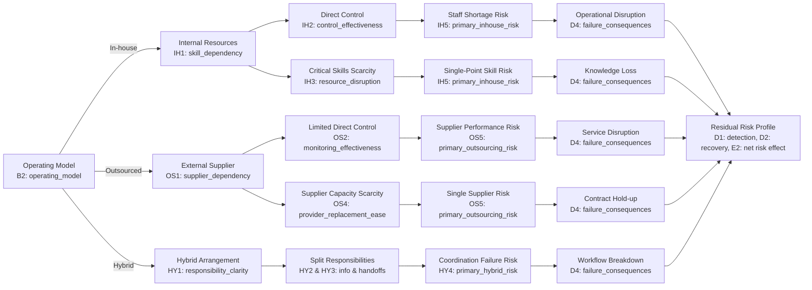

# Research Question to Empirical Variable Mapping Matrix
## Karelia UAS Bachelor's Thesis: Operational & Strategic Risk Comparison
**Thesis Title:** A Comparative Analysis of How In-House and Outsourced Operations Affect a Company’s Risk Profile  
**Academic Institution:** Karelia University of Applied Sciences  
**Authors:** Group Thesis (Two Researchers)  
**Dataset Reference:** [`DATA/responses.csv`](file:///c:/Users/Sav-Dev/Documents/research-validation-tables/BSC-STUDENT-RESEARCH/KINGSLEY%20AND%20XXX/DATA/responses.csv) ($N = 30$)  
**Document Purpose:** Master research traceability matrix connecting theoretical constructs, empirical survey variables, analytical methods, and thesis reporting chapters.

---

## 1. Central Research Question & Conceptual Framework

### Central Research Question:
> **How do in-house and outsourced operations affect a company's operational and strategic/business risk profile?**

### Conceptual Framework Analytical Chain:
$$\text{Operating Model} \longrightarrow \text{Resource Configuration} \longrightarrow \text{Control Distribution} \longrightarrow \text{Dependency Structure} \longrightarrow \text{Risk Exposure} \longrightarrow \text{Consequences} \longrightarrow \text{Response/Recovery} \longrightarrow \text{Residual Risk}$$

---

## 2. Research Question Alignment Matrix

| Research Question (RQ) | Theoretical & Conceptual Dimension | Survey Variable(s) | Survey Code(s) & Scale | Empirical Analytical Method | Thesis Reporting Location |
| :--- | :--- | :--- | :--- | :--- | :--- |
| **Context & Validity** Sample representation & participant validity | Contextual control variables; survey eligibility | `country` `industry` `role_function` `knowledge_level` `company_size` `activity` | A1 (Categorical) A2 (Categorical) A3 (Categorical) A4 (Ordinal filter) A5 (Ordinal band) B1 (Categorical) | Frequency counts ($n$), percentages ($n/N$), cross-tabulations | **Chapter 3** (Methods §3.3) **Chapter 5** (Results §5.1) |
| **RQ1: Operational Risks** What operational risks are associated with in-house and outsourced operations? | Operational risk exposure; Continuity risk; Process disruption; Failure impacts | `operating_model` `internal_resource_disruption` `primary_inhouse_risk` `supplier_disruption` `primary_outsourcing_risk` `primary_hybrid_risk` `failure_consequences` | B2 (Group variable) IH3 (Rating 1–10) IH5 (Categorical) OS3 (Rating 1–10) OS5 (Categorical) HY4 (Categorical) D4 (Multi-select) | Mean, median, SD; categorical percentage breakdown; consequence multi-response frequency table | **Chapter 5** (Results §5.2, §5.3, §5.4, §5.5) **Chapter 6** (Discussion §6.1) |
| **RQ2: Strategic & Business Risks** What strategic and business risks are associated with the operating models? | Strategic exposure; Net risk redistribution; Knowledge retention; Vendor lock-in | `operating_model` `overall_risk_effect` `failure_consequences` `provider_replacement_ease` `additional_insight` | B2 (Group variable) E2 (Categorical) D4 (`Knowledge Loss`, `Contract Hold-up`) OS4 (Rating 1–5) E3 (Open text) | Cross-tabulation ($B2 \times E2$); frequency of strategic failure tags; qualitative content analysis | **Chapter 5** (Results §5.6) **Chapter 6** (Discussion §6.2) |
| **RQ3: Control, Capabilities & Governance** How do control distribution, capabilities, and governance influence risk? | Governance mechanisms; Direct vs contractual control; Information asymmetry; Interface coordination | `internal_skill_dependency` `internal_control_effectiveness` `supplier_dependency` `supplier_monitoring_effectiveness` `responsibility_clarity` `cross_boundary_information` `handoff_effectiveness` `accountability_clarity` | IH1 (Rating 1–10) IH2 (Rating 1–10) OS1 (Rating 1–10) OS2 (Rating 1–10) HY1 (Rating 1–10) HY2 (Rating 1–10) HY3 (Rating 1–10) D3 (Rating 1–10) | Comparative descriptive statistics across operating models; mean/median score comparison | **Chapter 5** (Results §5.2, §5.3, §5.4) **Chapter 6** (Discussion §6.3) |
| **RQ4: Continuity, Disruption & Recovery** How do organizations manage continuity, disruption, and recovery? | Organizational resilience; Problem detection speed; Recovery capability; Operational flexibility | `problem_detection` `recovery_effectiveness` `internal_scalability` `provider_replacement_ease` | D1 (Rating 1–10) D2 (Rating 1–10) IH4 (Rating 1–5) OS4 (Rating 1–5) | Group comparison ($B2 \times D1, D2$); scalability vs switching cost analysis; resilience profiling | **Chapter 5** (Results §5.5) **Chapter 6** (Discussion §6.4) |
| **RQ5: Make-or-Buy Decision Factors** What factors should organizations evaluate in make-or-buy decisions? | Decision criteria; Transaction costs vs core capabilities; Trade-off evaluation | `make_buy_factors` `operating_model` `overall_risk_effect` | E1 (Multi-select) B2 (Group variable) E2 (Categorical) | Multi-response ranking frequencies; cross-tabulation by operating model | **Chapter 5** (Results §5.6) **Chapter 6** (Discussion §6.5) |

---

## 3. Detailed Variable Definitions & Measurement Rules

### 3.1 Background & Context Variables (Section A & B)
- **`profile_id`**: Unique integer ID (1–30) assigned chronologically to completed submissions.
- **`country` (A1)**: Country of operation for the assessed operating unit. Used for geographic balance verification (Finland 40% vs Europe 60%).
- **`industry` (A2)**: Primary industrial sector. Used as a descriptive context variable.
- **`role_function` (A3)**: Professional role/title of respondent. Confirms operational or decision-making qualification.
- **`knowledge_level` (A4)**: Operational familiarity. Verification filter (must be $\ge$ "Support decisions about it" or "Have professional experience with it").
- **`company_size` (A5)**: Enterprise size band (1–49, 50–249, 250–999, 1,000+). Control variable for organizational capacity.
- **`activity` (B1)**: Specific operational activity assessed (Production, Maintenance, IT, Logistics, Procurement).
- **`operating_model` (B2)**: Core independent grouping variable (*Predominantly in-house*, *Predominantly outsourced*, *A combination of in-house and outsourced*). Determines survey branching.

### 3.2 In-House Path Variables (Section C / IH)
- **`internal_skill_dependency` (IH1)**: Numerical rating (1–10). Extent to which the activity relies on internal specialist staff.
- **`internal_control_effectiveness` (IH2)**: Numerical rating (1–10). Perceived quality and direct process control achieved through in-house execution.
- **`internal_resource_disruption` (IH3)**: Numerical rating (1–10). Operational difficulty experienced if key internal staff are unavailable.
- **`internal_scalability` (IH4)**: Numerical rating (1–5). Ease of scaling capacity internally when demand changes.
- **`primary_inhouse_risk` (IH5)**: Categorical primary vulnerability (*Staff Shortage Risk*, *Single-Point Skill Risk*).

### 3.3 Outsourced Path Variables (Section D / OS)
- **`supplier_dependency` (OS1)**: Numerical rating (1–10). Degree of reliance on the external service provider.
- **`supplier_monitoring_effectiveness` (OS2)**: Numerical rating (1–10). Ability to inspect, monitor, and enforce service quality.
- **`supplier_disruption` (OS3)**: Numerical rating (1–10). Operational impact if the provider fails or halts service.
- **`provider_replacement_ease` (OS4)**: Numerical rating (1–5). Ease of switching suppliers or bringing the activity back in-house.
- **`primary_outsourcing_risk` (OS5)**: Categorical primary vulnerability (*Supplier Performance Risk*, *Single Supplier Risk*).

### 3.4 Hybrid Path Variables (Section E / HY)
- **`responsibility_clarity` (HY1)**: Numerical rating (1–10). Clarity of role boundaries between internal team and supplier.
- **`cross_boundary_information` (HY2)**: Numerical rating (1–10). Effectiveness of data sharing and communication across organizational borders.
- **`handoff_effectiveness` (HY3)**: Numerical rating (1–10). Management and execution of operational workflow handoffs.
- **`primary_hybrid_risk` (HY4)**: Categorical primary vulnerability (*Coordination Failure Risk*).

### 3.5 Common Evaluation & Resilience Variables (Section D & E)
- **`problem_detection` (D1)**: Numerical rating (1–10). Early detection capability before an operational defect causes downtime.
- **`recovery_effectiveness` (D2)**: Numerical rating (1–10). Speed and effectiveness of restoring operations after disruption.
- **`accountability_clarity` (D3)**: Numerical rating (1–10). Overall clarity of decision-making authority and operational accountability.
- **`failure_consequences` (D4)**: Multi-select string. Consequences if the activity fails (*Operational Disruption*, *Knowledge Loss*, *Service Disruption*, *Contract Hold-up*, *Workflow Breakdown*, *Customer or reputation damage*, *Safety or compliance consequences*).
- **`make_buy_factors` (E1)**: Multi-select string. Criteria driving make-or-buy decisions (*Cost*, *Quality*, *Control*, *Skills*, *Resilience*, *Scalability*, *Regulation*, etc.).
- **`overall_risk_effect` (E2)**: Categorical assessment of operating model impact on risk (*Some risks decreased while others increased* vs *Risks have generally increased*).
- **`additional_insight` (E3)**: Qualitative open-text response for additional lessons or controls.
